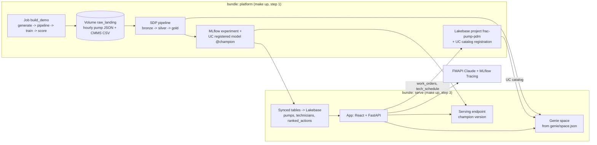

# Project Plan: Frac Pump Predictive Maintenance ("Fleet Reliability Command Center")

**Status:** v4 (simplified, DABs-forward) (after critique cycles 1-3; cycle 3 tie-out: 0 numeric mismatches, logic fixes applied) | **Owner:** Andrew Kraemer (SA) | **Date:** 2026-10-28
**Purpose:** FE Bar evaluation submission. One working end-to-end build plus a business deck.
**Numbers:** every figure below comes from `value_model/value_model_output.md` (generated by `value_model.py`). Change log is in section 13.

---

## 0. One-paragraph pitch

Mesa Ridge Pressure Pumping (fictional) runs 15 dual-fuel frac fleets in the Permian: 300 active pumps and 60 standby. The modeled numbers:

- Unplanned pump failures cost an estimated **$11.9M a year**.
- Fluid ends, retired on a calendar, cost **~$61M a year**, its largest maintenance line.

The Fleet Reliability Command Center ingests pump telemetry, predicts which pump will fail and how within the next 24 pumping hours, prices the three options (keep running, swap at the next stage gap, pull now), and dispatches a technician. Run as a condition-based maintenance program, it's worth an estimated **$9.1-10.9M a year**. That's **$0.6-0.7M per fleet, or 3-4% of fleet EBITDA**:

- **$1.7-3.6M is directly ML-attributable** (failures caught early) and is proven in the POC backtest.
- **$7.3M comes from program levers** (fluid end life, consumables) that the same data enables and the pilot proves.

*All figures are modeled from public benchmarks; the POC replaces them with Mesa Ridge's CMMS, AP, and pump-hour data.*

---

## 1. Requirements traceability (the evaluator's checklist)

| # | Requirement | How we satisfy it | Evidence committed (text) |
|---|---|---|---|
| R1 | Specific industry problem + Outcome Map | Pressure pumping, unplanned frac pump failures. Energy Outcome Map, *Optimize Operations*, Predictive Maintenance / Asset Reliability (uptime, MTBF, MTTR). **Names to verify against the official map (Q2)** | Plan, deck slide 3 |
| R2 | Raw dataset (synthetic) | 12 months of physics-informed, hourly edge-aggregated pump features + CMMS | `evidence/01_data_and_pipeline.md` |
| R3 | **Lakeflow** | Auto Loader (JSON telemetry + CSV CMMS) into a Spark Declarative Pipeline, bronze to silver to gold, with expectations; deployed by bundle | `evidence/01_data_and_pipeline.md` |
| R4 | **Unity Catalog** | Grants in bundle YAML, comments, tags, column mask (`technicians.phone`), lineage | `evidence/02_governance.md` (mask shown as app SP vs admin) |
| R5 | **Lakebase** | Autoscaling project + synced tables + UC catalog from the bundle; native OLTP written by the app | `evidence/04_lakebase.md` |
| R6 | **ML** | Calendar-rule baseline vs calibrated LightGBM in MLflow, UC `@champion`, batch scoring + serving endpoint | `notebooks_executed/train.ipynb` (with outputs), `evidence/03_ml_mlflow.md` |
| R7 | **GenAI** | Grounded AI work order (FMAPI Claude, MLflow Tracing, human approval) + Genie in the app | `evidence/06_genai_genie.md` |
| R8 | **Genie Agent** | Genie space from `genie/space.json` (bundle) over gold, value tables, and work orders; 3 benchmarks | `evidence/06_genai_genie.md` |
| R9 | **Databricks App** | React + FastAPI (APX), deployed by the serve bundle | `evidence/07_app_api.md` |
| R10 | App shows ML predictions | Every payload carries `model_name` and `model_version` | `evidence/07_app_api.md` |
| R11 | Operational layer: dispatch + timelines | Work order lifecycle, tech assignment to stage-gap windows, 48-hr Gantt | `evidence/05_ranked_actions_dispatch.md` |
| R12 | Action that makes the most money | `decide_action()` prices 3 options, and ranked actions are sorted by expected $ | `evidence/05_ranked_actions_dispatch.md` |
| R13 | Integrated, not siloed | One record traced across all six stages in a single run | **`evidence/08_end_to_end_trace.md`** (see 5.10) |
| R14 | Evidence readable as text, reproducible | `make evidence` regenerates every evidence file; `make down/up` rebuilds from scratch | README master map, `scripts/check_evidence.sh` output |
| R15 | Deck: outcome-led, buyer KPIs, sponsor + owner | Tell-show-tell; KPIs per persona with baselines | `presentation/deck.md` |
| R16 | Next steps as POC/DOC | 6-week POC, week-1 data gate, success criteria on one curve, DOC | Deck slide 12 |
| R17 | No real customer data | Fictional company + names, synthetic data | `scripts/scrub_check.sh` output |
| R18 | Readable GitHub repo | Personal public GitHub repo (decided) | Link |

---

## 2. Customer story and personas

**Company:** Mesa Ridge Pressure Pumping (fictional; name-checked before publishing). 15 dual-fuel fleets, Midland and Delaware. Each fleet has 20 active and 4 standby pumps, quintuplex, 2,500 HHP, stainless fluid ends.

| Persona | Role | Needs | KPIs with modeled baseline |
|---|---|---|---|
| **Dana Ortiz, VP Operations** (sponsor) | Signs the POC | EBITDA, fewer customer escalations, safety | EBITDA/fleet ~$18M; pump-caused NPT ~24 hrs/fleet/yr; ~279 unplanned repairs/yr (red-zone exposure) |
| **Marcus Lee, Director of Fleet Reliability** (owner) | Champion, owns the cost table and threshold | What to fix first, fewer surprises, longer fluid end life | Fluid end life 1,600 hrs; fluid end spend ~$4.1M/fleet; consumables ~$1.2M/fleet; MTBF (computed in gold from CMMS) |
| **Field service supervisor** | Daily user | Ranked list per stage gap, who's free, parts, work order | Work orders closed in window, MTTR |

**Demo storyline: the loud pump vs the expensive pump** (synthetic, scripted, labeled as such). Output from `decide_action()`:

| Rank | Pump | Mode, signal | Risk (24 hr) | Best action | Expected $ protected |
|---|---|---|---|---|---|
| 1 | **F07-P09** | Power end bearing. Quiet: lube oil +9°F, crank LF vibration creeping | 0.72 | Pull now, standby online | **$48.7k** |
| 2 | **F07-P14** | Valve/seat washout. Loud: cylinder 3 valve impact energy rising | 0.86 | Swap at next stage gap | **$26.1k** |
| 3 | F03-P02 | Packing failure: packing temp rising, lube delivery dropping | 0.55 | Swap at next stage gap | $10.7k |

**Talking point:** the loud pump has the higher risk score, but the quiet pump is worth nearly twice as much. If a washout retires the whole fluid end (damage factor 1.0 instead of 0.4), F07-P14 jumps to $59k and ranks first. That's why Marcus owns the cost table and the POC calibrates it. The demo also shows **one miss and one false alarm**, with root cause for each.

---

## 3. Value model (single source of truth)

`value_model/value_model.py` is tagged SOURCED, ESTIMATE, or VALIDATE. It writes `value_assumptions.csv`, `mode_costs.csv`, and `value_model_output.md`. The scoring job imports `decide_action()` from the same module, so the app, deck, and Genie can't disagree.

**Three levers**

| Lever | Mechanism | Measured in |
|---|---|---|
| 1. Failures caught early **(ML-attributable)** | The 24-hr failure-mode classifier flags valve/seat, packing, and power end failures, so the fix happens in a stage gap instead of a breakdown | POC backtest |
| 2. Fluid end life +10% (program) | The same telemetry flags **cavitation and operating-envelope abuse** (low suction at high HHP, pressure spikes). The suction-side fix extends fluid end life, the root cause behind Evolution's +63%. Analytics, not the classifier. **Accounting caveat:** if fluid ends are capitalized, this is capex/cash, not EBITDA, so confirm with the controller | Pilot |
| 3. Consumables -10% (program) | Valves, seats, and packing are replaced on condition, not hours (Baker Hughes: +27% valve life) | Pilot |

**Key outputs** (conservative = 25% caught at 50% precision; target = 50% at 35% precision, both points on the same threshold curve)

| | Conservative | Target |
|---|---|---|
| Unplanned events/yr (valve/seat 152, packing 82, power end 45) | 279 | 279 |
| Modeled cost of unplanned failures | $11.9M | $11.9M |
| Pump-caused spread NPT (24 hrs/fleet; deliberately conservative vs non-pumping time of 8-12%) | 362 hrs | 362 hrs |
| **Lever 1 (ML), net of false alarms + $0.6M run rate** | **$1.7M** | **$3.6M** |
| Lever 2, fluid end life | $5.5M | $5.5M |
| Lever 3, consumables | $1.8M | $1.8M |
| **Program total (steady-state, yr-1 implementation excluded)** | **$9.1M** | **$10.9M** |
| Per fleet / % of fleet EBITDA (ProPetro basis; higher on weaker-margin pumpers) | $0.60M / 3.4% | $0.73M / 4.0% |
| Lever 1 only, % of fleet EBITDA | 0.6% | 1.3% |
| EBITDA under any accounting (levers 1 + 3) | $3.5M | $5.4M |
| Spread hrs recovered (context only, not added to $) | 91 | 181 |
| False alarms per pump-month | 0.02 | 0.07 |
| Break-even precision ($37.4k avg net value per catch vs $4k per false alarm: standby swap + teardown inspection) | 9.7% | 9.7% |
| Payback, program (impl only / + $3M sensor allowance) | 1.0 / 5.0 months | 0.8 / 4.1 months |
| Payback, lever 1 only (impl only / + sensors) | 5.2 / 26 months | 2.5 / 13 months |

**Sensitivity:**

| Assumption | Range | Lever 1 or program result |
|---|---|---|
| Fluid end life extension | 5-20% | Program **$6.4-13.7M** (biggest swing) |
| Valve washout damage factor | 0.2-1.0 | Lever 1 $1.2-3.2M |
| Unplanned fluid end share | 10-35% | Lever 1 $0.8-2.3M |
| Power end rate | 0.05-0.25 | Lever 1 $1.2-2.3M |
| Share of failures that stop the spread | 0-100% | Lever 1 $1.4-2.1M |
| Consumables reduction | 5-20% | Program $8.2-10.9M |

**Validation rules (re-checked every iteration):**
1. Every number traces to `value_model_output.md` or a cited source.
2. The conservative catch rate (25%) sits inside the analyst range (McKinsey 20-30% less unplanned downtime).
3. No double counting:
   - lost spread hours are valued once, at margin;
   - stages are context only;
   - cavitation is valued only in lever 2, not as a lever 1 event;
   - lever 1's fluid end damage is avoided early retirement from washouts (event-driven), while lever 2 is wear-driven life extension.
4. Headline numbers are marked "est."; the ML-attributable vs program split is always visible.
5. Forecast values say "expected" or "$ protected." "Saved" is reserved for realized outcomes, and the seeded realized outcomes are labeled synthetic.
6. Synthetic data calibrated to the value model is circular. It proves the pipeline works, not the value, and we say so.

---

## 4. Architecture (DABs-forward, ~4.5 hr build)



**Lifecycle (one command each):**
| Command | What it does |
|---|---|
| `make up` | (1) deploy the platform bundle; (2) run job `build_demo` (generate data, pipeline update, train + register `@champion`, batch score + ranked actions); (3) read the champion version, then deploy the serve bundle with `model_version=N`; (4) start the app |
| `make evidence` | `scripts/collect_evidence.py` queries every stage and rewrites `evidence/*.md` (rerunnable after any redeploy) |
| `make down` | destroy the serve bundle, then the platform bundle (schema, volume, pipeline, jobs, experiment, model, Lakebase project with purge) |
| `make redeploy` | down, then up. Target: under 30 min on serverless |

Two bundles, because synced tables, the endpoint, and the Genie space can't be created until data and a model version exist. Everything is parameterized with bundle variables (`catalog`, `schema`, `warehouse_id`, `model_version`, `llm_endpoint`), so a second target in another workspace is a copy-paste.

---

## 5. Component specs (simplified)

### 5.1 Names
Workspace `fevm-production-forecasting` (profile `fe-vm-production-forecasting`), catalog `production_forecasting_catalog`, **schema `frac_pump_pdm`**, warehouse `6f1ac903576b114a`, LLM `databricks-claude-sonnet-4-6`, Lakebase project `frac-pump-pdm`, app `frac-reliability-center`, model `frac_pump_failure_model`, endpoint `frac-pump-failure-scorer`.

### 5.2 Synthetic data (one notebook, task 1 of `build_demo`)
- **Hourly edge-aggregated features**, 12 months: 300 pumps x 5,000 pumping hrs = **~1.5M rows**, written as JSON files to the volume. That's small, fast, and still shows 2-100 hr precursors.
- Dims: `fleets`, `pumps`, `technicians`, `parts_catalog`, `procedure_library` (~12 synthetic procedures) as CSV. CMMS `maintenance_events` CSV (~940 fluid end changes, calendar valve changes, ~279 unplanned).
- Fields: suction/discharge psi, rpm, theoretical rate, valve impact energy c1-c5, power end LF vibration, kurtosis, pulsation, packing temp, lube oil temp/psi, proppant.
- Realism: per-mode precursors, normalized by rate, calendar valve changes as the counterfactual, false precursors, dropouts, seeded misses. Hero pumps F07-P09 / F07-P14 / F03-P02 are scripted.
- **Live moment:** `scripts/drop_file.py` lands one new hour for F07-P09, and the pipeline picks it up. No replay job.

### 5.3 Lakeflow pipeline (one SDP, 6 tables, serverless)
`bronze_telemetry`, `bronze_maintenance` (Auto Loader) -> `silver_telemetry` (expectations: psi range and rpm >= 0 drop, null rate warn) -> `gold_pump_features` (rolling 6/24 hr mean, slope, max; cylinder imbalance; hrs since last valve change), `gold_failure_labels` (mode within the next 24 pumping hrs), `gold_fleet_kpis_daily` (pump NPT, failures, MTBF, maintenance $). Table and column comments are defined in the pipeline code, so governance ships with the data.

### 5.4 Unity Catalog governance (in the bundle)
- Schema and volume `grants` in YAML.
- Table and column comments in SDP.
- One column mask on `technicians.phone`, set by a SQL task in `build_demo`; phone is excluded from the synced table.
- Tags. Lineage evidence from `system.access.table_lineage`.
- *Cut:* row filters.

### 5.5 ML (one notebook, task 3)
- Two MLflow runs: `calendar_baseline` (hours-since-change rule) vs `lightgbm_calibrated` (LightGBM + isotonic via `CalibratedClassifierCV`).
- Time split: months 1-9 train, 10-12 test.
- Metrics: event recall per mode (with n), precision, false alarms per pump-month, median lead time, **annualized $ captured vs baseline**, Brier score.
- Text artifacts.
- Register in UC and set `@champion`.
- If the model doesn't beat the baseline, report it honestly.

### 5.6 Batch score + ranked actions (task 4)
- Load `models:/...@champion` and score the latest hour per pump into `gold_pump_risk_scores`.
- Call `value_model.decide_action()` per pump above the threshold to build `gold_ranked_actions`, with every input exposed plus `model_version`.
- `value_assumptions` and `mode_costs` load from the CSVs.

### 5.7 Lakebase (serve bundle + app)
- Bundle: `postgres_projects` (platform), `postgres_catalogs` (UC registration), and `postgres_synced_tables` (snapshot mode) for `pumps`, `technicians` (no phone), `ranked_actions`.
- Native tables `work_orders`, `tech_schedule`, `wo_events` are created by the app on startup with `CREATE TABLE IF NOT EXISTS`. Seeded with history (`is_synthetic_seed`).
- Fallback if bundle-native synced tables fail: task 4 writes `ranked_actions` to Lakebase with psycopg.

### 5.8 App (React + FastAPI via APX, 2 views)
1. **Ranked Actions (hero):**
   - table ranked by expected $, with the 3-option comparison;
   - row drawer with sparkline, drivers, and "Re-score with endpoint";
   - a **Dispatch** button opens a modal: AI-drafted work order (FMAPI, grounded in `procedure_library`, cites the procedure ID, MLflow traced), pick tech and stage-gap window, **Approve & save** writes to Lakebase.
2. **Timeline:** a 48-hr Gantt of `tech_schedule` and work orders by technician, with status updates. A **Genie side panel** is on both views (Conversation API, showing SQL + results).

The app's resources (warehouse, endpoint, Genie space, Lakebase) are bound in the serve bundle, so permissions deploy with it.

### 5.9 Genie space (serve bundle)
`genie/space.json` (serialized space) is checked in and deployed through the bundle's `genie_spaces` `file_path`. Sources: gold KPIs, risk scores, ranked actions, maintenance events, value tables, and Lakebase `work_orders` (via the UC catalog). It includes instructions, 6 sample questions, and 3 benchmark questions with expected SQL. *Cut:* metric view.

### 5.10 End-to-end trace (R13)
`scripts/trace_e2e.py`: drop file -> pipeline -> score -> synced `ranked_actions` -> `POST /work_orders` -> Lakebase row -> Genie answer. Output goes to `evidence/08_end_to_end_trace.md`.

---

## 6. Repo structure
```
README.md  DECISIONS.md  Makefile
bundles/platform/databricks.yml + resources/*.yml   # schema, volume, pipeline, jobs, experiment, model, lakebase project+catalog
bundles/serve/databricks.yml + resources/*.yml      # synced tables, endpoint, genie space, app
src/ data_gen/ pipeline/ ml/ app/   genie/space.json
value_model/   scripts/ (collect_evidence.py, trace_e2e.py, drop_file.py, check_evidence.sh, scrub_check.sh)
evidence/      # 8 .md files, each <6k chars, generated by make evidence
notebooks_executed/  presentation/deck.md  docs/ (plan, research, speaker notes, roleplay prep)  tasks/
```

---

## 7. Build phases (~4.5 hrs core + 1 hr buffer)

| Phase | Work | Est. | Gate (technical / business) |
|---|---|---|---|
| 1 | Repo init; platform bundle skeleton; **smoke test** (deploy a postgres project + one synced table + a genie space from a bundle, then destroy); data gen notebook | 1.0 | Smoke test passes or fallback chosen; event counts match the value model (calibration) |
| 2 | SDP pipeline + governance task | 0.5 | Update COMPLETED + expectation metrics; gold NPT ≈ 362 hrs/yr |
| 3 | Train + register + score + ranked actions | 0.75 | Model beats the calendar baseline on annualized $; F07-P09 ranks #1 |
| 4 | Serve bundle: synced tables, endpoint, Genie space | 0.5 | psql shows rows; endpoint returns `model_version`; Genie answers a $ question |
| 5 | App (2 views + modal + Genie panel) | 1.25 | curl on every route; demo runs in under 7 min |
| 6 | `make evidence`, E2E trace, README, DECISIONS, deck refresh, **full down/up rehearsal** | 0.5 | `check_evidence.sh` passes; redeploy works from a clean slate |
| | Buffer | 1.0 | |

Commit at the end of every phase. **Cut list if behind:** "Re-score with endpoint" button (keep the curl), then Genie benchmarks, then seeded work order history. **Never cut:** evidence, the E2E trace, Lakebase writes, the MLflow baseline comparison, or the down/up rehearsal.

**What got simplified (v4) and why it doesn't hurt the score:**
| Cut | Why it's safe |
|---|---|
| 5-minute to hourly data (18M to 1.5M rows) | Precursors are 2-100 hrs; hourly still shows them, and every run is faster |
| Parquet + JSON live replay job | One format; one `drop_file.py` gives the live moment |
| 4-5 app pages to 2 views + modal | Every user requirement is still on screen: predictions, $ ranking, dispatch, timeline, AI work order, Genie |
| Threshold panel, what-if slider, fleet overview, row filter, metric view | Nice-to-have; none are required |
| Separate DDL, governance, and replay jobs | Folded into one `build_demo` job and the app's startup |
| Hand-written evidence | Generated by `make evidence`, so it's always current after a redeploy |

---

## 8. Demo script (tell-show-tell, ~15 min, ~7 min live)
1. **Tell (2 min):** $9.1-10.9M on the table, $1.7-3.6M of it from the model. What changes for Dana and for Marcus.
2. **Show (7 min):**
   1. Ranked Actions: the quiet power end (F07-P09, $48.7k, pull now) beats the loud valve (F07-P14, $26.1k, swap at gap).
   2. Drawer: drivers, the 3 options, and "If washouts retire your fluid ends, the valve jumps to #1; that's your cost table."
   3. Dispatch: AI work order, approve, assign to the 14:20 gap, and the Timeline updates.
   4. Genie: "Expected $ protected by this week's work orders, by fleet?"
   5. 60 seconds under the hood: bundle, pipeline, MLflow baseline vs model, Lakebase. Show one miss and one false alarm.
3. **Tell (3 min):** the value recap, then the POC with a week-1 data gate.

---

## 9. Top risks
| Risk | Mitigation |
|---|---|
| Bundle-native synced tables or Genie space don't deploy | Phase 1 smoke test; fallback is SDK calls in a `build_demo` task + a teardown task |
| App + 4 integrations in one deploy | Resources bound in the serve bundle; build routes against curl first, UI second |
| Model doesn't beat the baseline | Report it honestly; tune features once |
| Synthetic metrics look too good | Noise, false precursors, seeded misses |
| Endpoint cold start | Pre-warm in `make up`; batch-score fallback |

---

## 10. Open questions
- **Q2 (open, blocks the build start):** the user re-auths Glean/Confluence for the FE Bar rubric, POC/DOC template, and official Outcome Map names.
- **Q3b (open):** "Mesa Ridge" collides with the real Mesa Ridge Holdings LLC / Mesa Ridge Midstream. Rename?
- Decided: personal public repo (Q1); Beusa verified (Q4).

---

## 11. Out of scope (said aloud)
Engines, transmissions, iron, blenders, e-frac motors/VFDs (the other ~67% of NPT); sensor retrofit design; CMMS write-back.

---

## 12. FE Bar validator constraints (go/fe-bar-faq, Oct 2026)
- **The scorer reads at most 30 files, 9k chars each, 90k total.** The validator-facing layer is README + DECISIONS + 8 evidence .md + deck + key bundle YAML, about 70k chars. Planning docs live in `docs/`.
- **Evidence goes in `.md` files** (a Sept 2026 bug stripped .txt/.json/.log). The README has a master map, and the submission decisions box names the paths.
- **Integrity checks:** commit authorship, plagiarism, prompt injection, Solution Builder detection. Commit per phase; DECISIONS.md documents the trade-offs and the AI-assisted workflow.
- **Domains:** Product, Industry, Build + AI Mindset, Customer Skills. The Yoodli roleplay (business + technical persona, ~25 min) needs a live demo and must close with next steps; prep is in `docs/roleplay_prep.md`.

---

## 13. Change log
- **v4:** simplified to ~4.5 hrs core; DABs-forward with two bundles (platform, serve) and make targets up/down/redeploy/evidence; hourly data; one build job; 2-view app; evidence generated by script; cuts listed in section 7.
- **v3.2:** repo moved to `~/projects/0_db_public_repos/fe_bar`; validator constraints.
- **v3.1 (cycle 3):** standby pricing, false alarm cost $4k, slide 1 operational number, Beusa verified.
- **v3 (cycle 2):** ML vs program split, lever 2 mechanism, shared `decide_action()`, payback with and without sensors.
- **v2 (cycle 1):** active pumps, margin-valued NPT, per-mode costs, calibrated model, calendar baseline.
- **v1:** initial plan.
